# Performance Comparison `v12.0.1` vs `v12.1.0-rc2`

## Comments

- Results are nominal, with no systemic regressions:
  - Unbounded test: the unbounded test shows no significant difference in the number of supported users (a 0.18% decrease), which lies in the \[-5%, +5%\] interval of usual variance.
  - Bounded test: the bounded test shows no significant difference in any of the metrics considered. Average API and store times are flat or slightly improved across the board (e.g. `getProfileImage` avg 89ms -> 31ms, `getPostsForChannelAroundLastUnread` avg 433ms -> 354ms).
- A few p99 outliers are worth noting, none of which is reflected in the supported users or in the average times:
  - Bounded: `searchPostsInTeam` p99 997ms -> 1.948s (+95.43%) and `searchPostsInAllTeams` p99 1.9s -> 3.481s (+83.21%), while their averages improved (`searchPostsInTeam` avg 164ms -> 152ms). `PostStore.AnalyticsPostCount` avg went from 569ms to 752ms (+32.15%), a background analytics query rather than a user-facing path. The release includes a change to numeric search term handling (`expandNumericTerms` in `sqlstore/utils.go`) and changes to the posts full-text index migrations (000217/000234), which could plausibly explain search tail latency, but the evidence is weak given the flat averages.
  - Unbounded: `followThreadByUser` p99 46ms -> 459ms (+902.73%), `getChannelMembers` p99 10ms -> 49ms, `getChannel` p99 113ms -> 170ms, `ChannelStore.GetTeamChannels` p99 95ms -> 225ms and `PropertyFieldStore.GetForGroup` p99 43ms -> 325ms. These are tail-latency spikes at saturation and the same operations are neutral or improved in the bounded test (`ChannelStore.GetTeamChannels` p99 98ms -> 50ms). The `GetTeamChannels` and `GetForGroup` changes could be linked to the ABAC/attributes work (channel and team list hydration now uses a JSONB containment check on `AccessControlPolicies`, and the `ChannelAttributes`/`PropertyFieldGraph` flags now default to on), but nothing suggests a sustained regression.
- Several operations improved notably in the unbounded test, e.g. `createChannel` avg 982ms -> 682ms (\-30.53%), `searchPostsInAllTeams` avg 1.104s -> 838ms (\-24.09%) and `createCategoryForTeamForUser` p99 485ms -> 50ms (\-89.69%).

## Action Items

- Release can continue as planned.
- No other action needed. Optionally, keep an eye on search p99 latency and on `followThreadByUser`/`PropertyFieldStore.GetForGroup` tail latency in the next comparison.

## Setup

| Setting                              | Value                                                                                              |
| ------------------------------------ | -------------------------------------------------------------------------------------------------- |
| Load-test version                    | [`v1.33.0`](https://github.com/mattermost/mattermost-load-test-ng/releases/tag/v1.33.0)            |
| Dataset                              | [Dump from `v11.10.1`, 12M posts](https://lt-public-data.s3.amazonaws.com/12M_11.10.1_psql.sql.gz) |
| Users file                           | [`12M_11.10.1_users.txt`](https://lt-public-data.s3.amazonaws.com/12M_11.10.1_users.txt)           |
| Bounded - number of users            | 6500                                                                                               |
| Bounded - duration                   | 90 minutes                                                                                         |
| Unbounded - MaxActiveUsers           | 20000                                                                                              |
| Unbounded - num of users per agent   | 2000                                                                                               |
| App instances                        | 2 x c7i.2xlarge                                                                                    |
| Agent instances                      | 11 x c7i.xlarge                                                                                    |
| Proxy Instance                       | 1 x c7i.xlarge                                                                                     |
| DB instances                         | 2 x db.r7g.2xlarge                                                                                 |

## Results

### Grafana

These are snapshots of the original Grafana dashboards.

- [Bounded test](https://snapshots.raintank.io/dashboard/snapshot/jm3FEZnlr338HlSsae2SPIZFTaimeEc4)
- [Unbounded test](https://snapshots.raintank.io/dashboard/snapshot/olPMTegCnIOa0Po4B0JOKnhPk4LmCfyB)

### Supported users in unbounded test

| v12.0.1 | v12.1.0-rc2 | Delta   |
| ------- | ----------- | ------- |
| 16933   | 16903       | \-0.18% |

### Graphs - Bounded

| 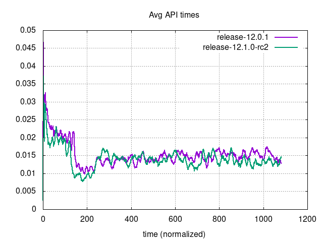 | 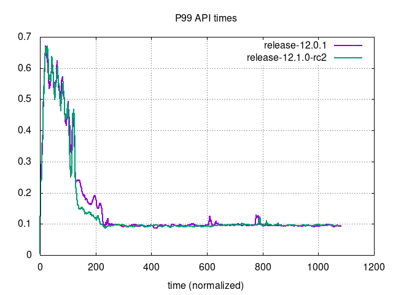 |
| --- | ---|
| 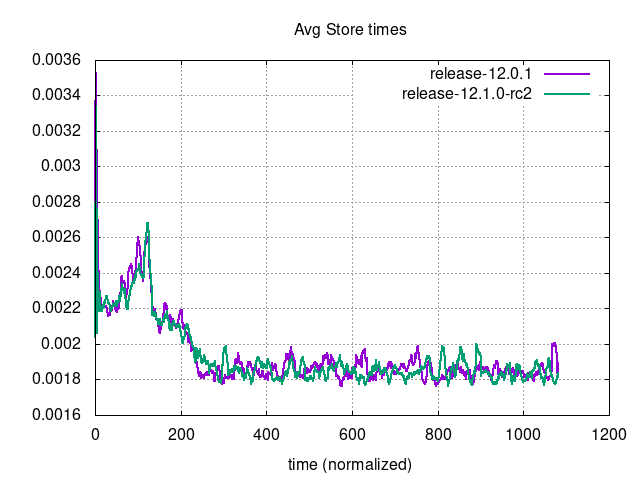 | 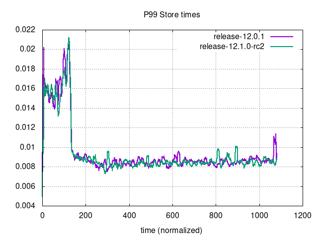 |
| 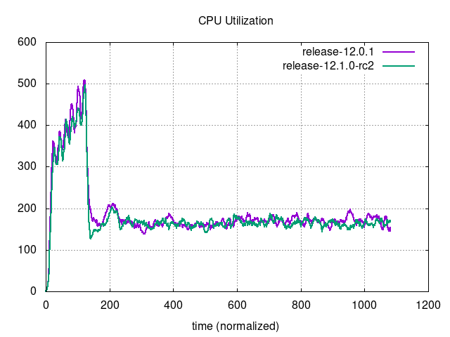 | 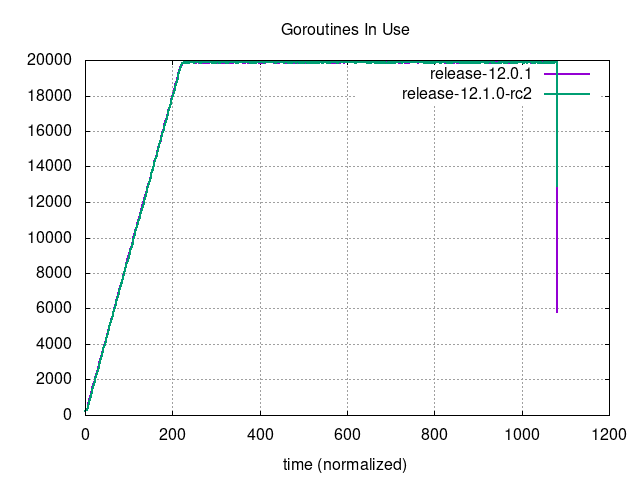 |
| 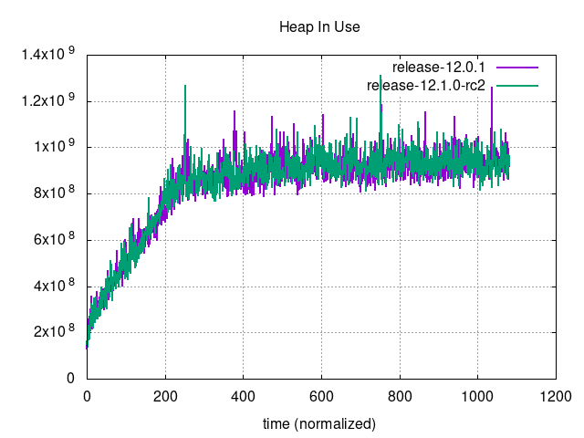 | 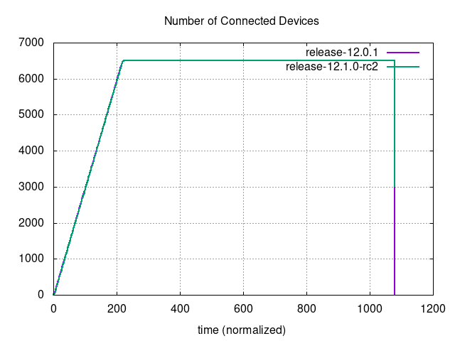 |
| 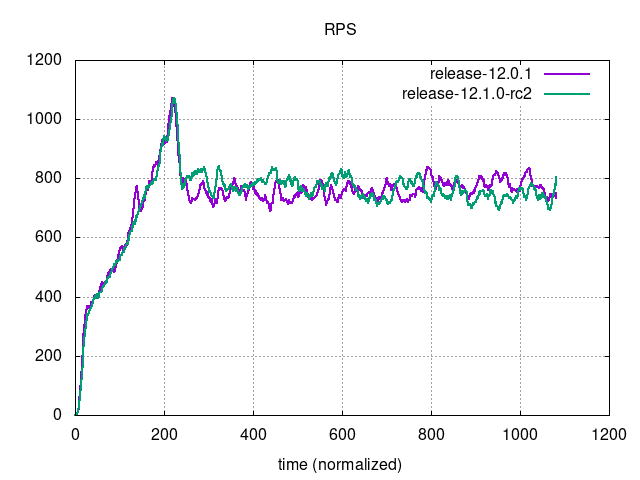 | 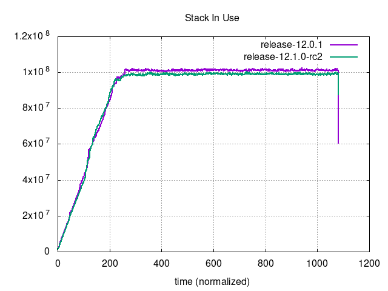 |

### Graphs - Unbounded

| 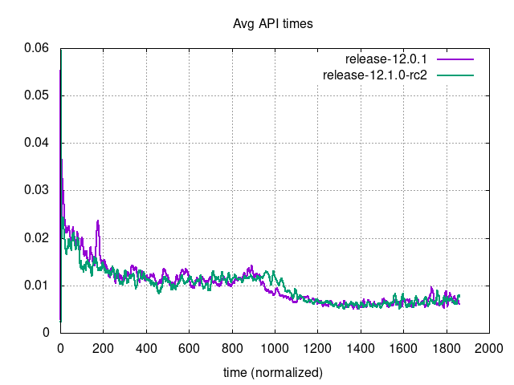     | 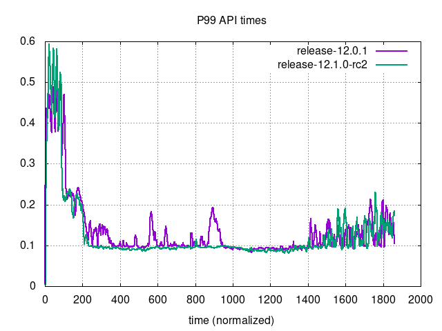                             |
| --- | ---|
| 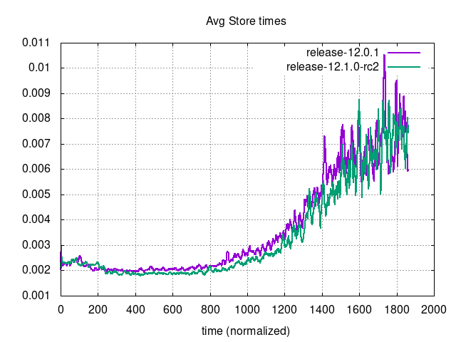 | 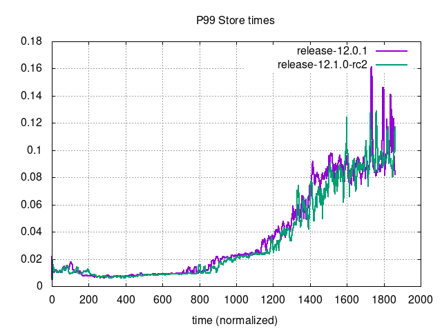                         |
| 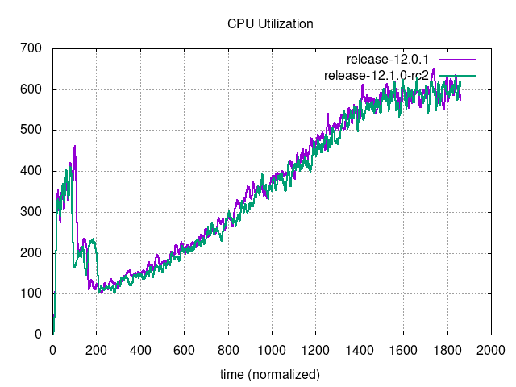 | 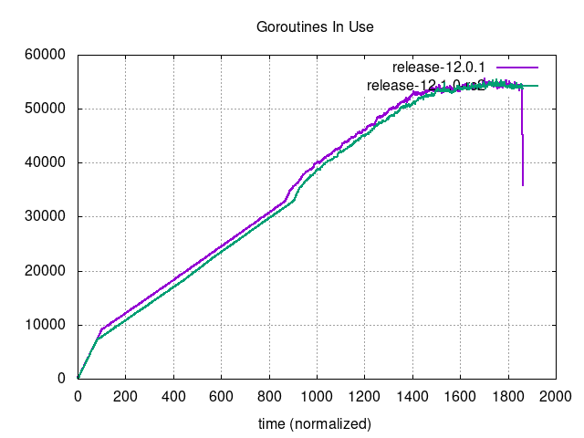                     |
| 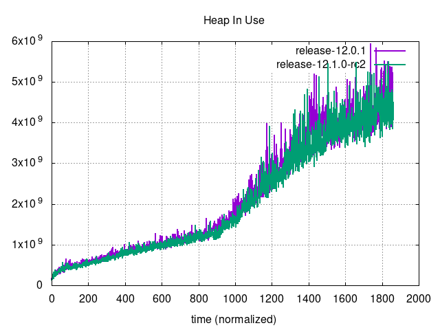         | 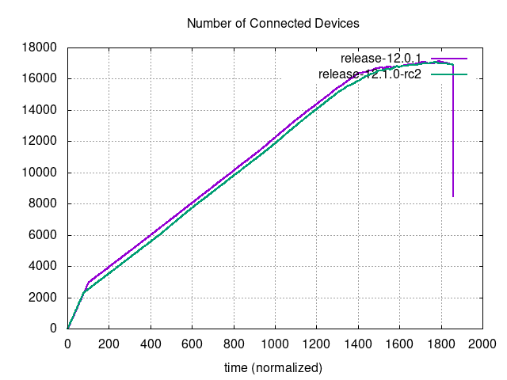 |
| 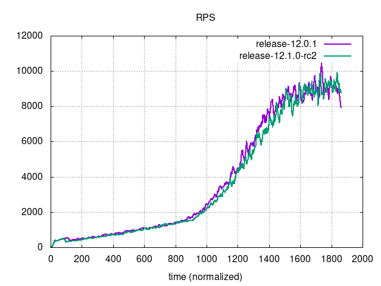                         | 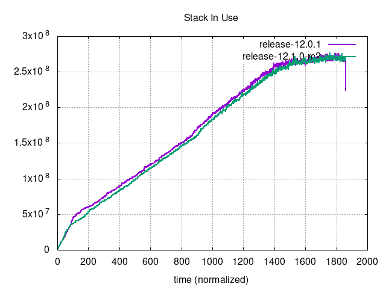                               |
